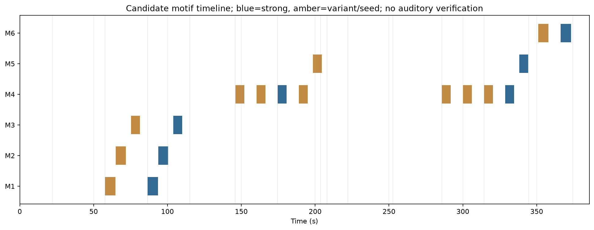
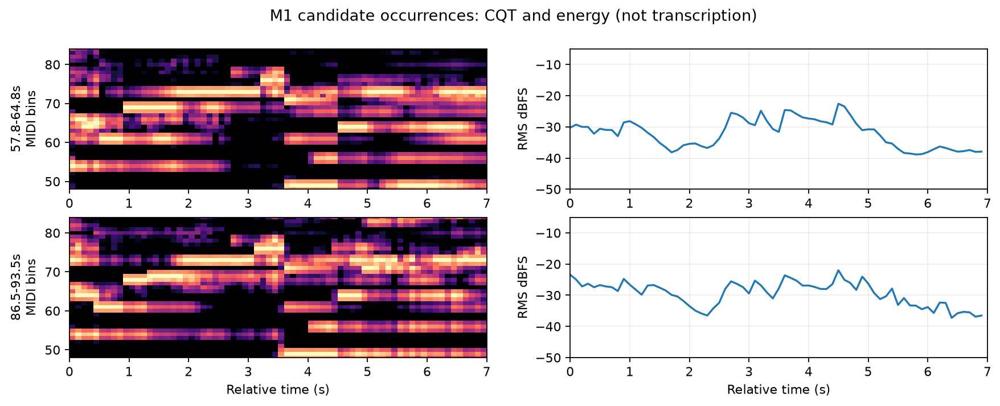
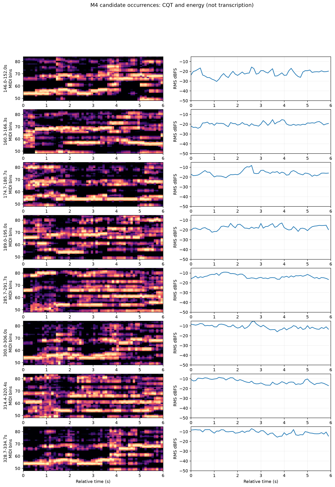
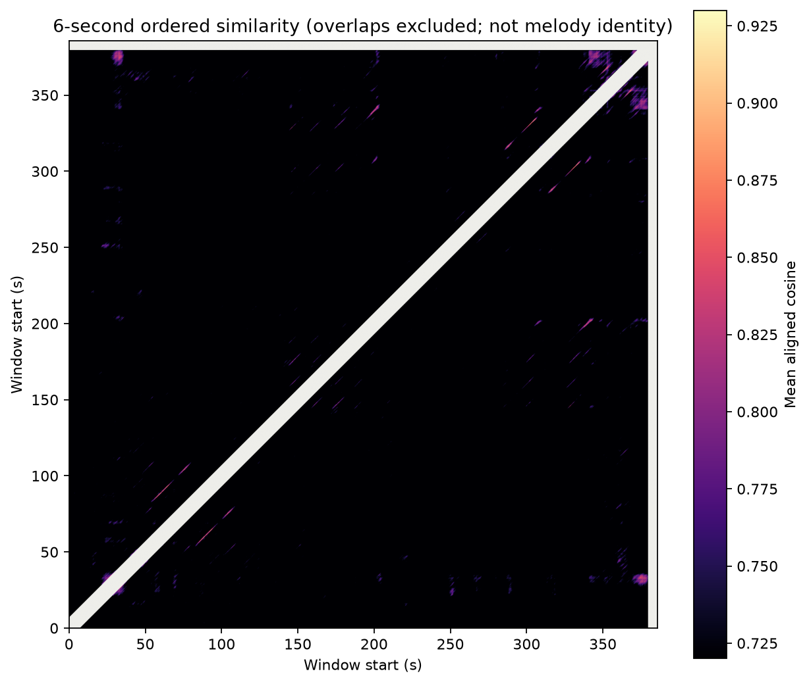

# 短动机候选与重复位置：M1–M6

**这是一份候选检索与频谱复查报告，不是听辨确认的主题目录。** 已核对实际音频中的连续音高能量轨迹，尚不能可靠分离旋律、内声部与泛音。所有时间戳都对应 [README](README.md) 所列哈希的录音；窗口长 6–7 秒，属于用户要求的 2–10 秒范围。

## 1. 什么算重复证据

本次没有把“整段 chroma 均值相似”当作动机重复。比较的是逐时变化的 C4–B6 频谱及八度折叠后的音高类别序列，并检查：

1. 是否有连续数秒的时间顺序对应，而非一个和弦长时间不变；
2. 保留音区的特征与不区分八度的特征是否互相支持；
3. 有限伸缩 DTW 后是否仍成立；
4. 与 0.5 秒块随机重排相比，原顺序是否具有额外相似度；
5. 局部 CQT 图是否显示相似的转折，而不是只有共同的底色；
6. 低频、能量、起音包络是否不同，以免把“所有层面都一样”预设为成立条件。

本报告用“强候选”指固定窗口 DTW 约 ≥0.84、顺序增益约 ≥0.05，并有局部图与上下文支持的配对。阈值是事后工作分级，**不具有概率/统计显著性的含义**。其余按中等变形、弱或间接关联保留。即便“强”，也还不是耳听确认的同一主旋律。

**完整性边界：** 下表列出本次核心六组的全部报告窗口，并另外列出值得复听的边缘候选；程序还保存全部保留匹配峰。不能宣称“全曲没有其他动机”或“这些绝对是首次出现”。快速装饰音、跨音区迁移、旋律被伴奏掩盖、大幅速度变化均可能漏检。

## 2. 六个候选的身份与最早定位窗口

| ID | 本轮最早采用的窗口 | 可辨识的计算轮廓/节奏线索 | 身份解释与保留条件 |
| --- | --- | --- | --- |
| M1 | **00:57.8–01:04.8** | 前部中高音能量上移，后部在相近高位反复分布；回返的时间轨迹清楚，约 7 秒 | 把它看作“上行展开后停留”的短旋律候选。CQT 包含重叠声部，不能从最大 bin 直接写成音符串。00:35.6 附近有弱近似，不能排除更早前身 |
| M2 | **01:05.0–01:11.8** | 前部较稳定的中高位置，随后短暂上探，再向较低位置集中；窗口内部的顺序信息较强 | M1 后的对比/接续候选。只把它称为“后一句”仍属 L2；尚未确认问答句法。02:34.6 有弱关联需听辨 |
| M3 | **01:15.3–01:21.3** | 中部较长的持续能量轨迹，后部向低处转移；第二次的低频轨迹几乎同序 | 较稳定的后部短句候选，不因其中有长音就把整窗认作假重复。00:50.0 有弱近似，首次身份未定 |
| M4 | **02:26.0–02:32.0** | 数次短上行与折返形成波动；约 MIDI 66–69 周围的上层轨迹与低八度附近轨迹同时可见 | 反复最广的候选族。相隔约 14.3 秒的成员并非等强证据；有的可能只是共同材料片段。上下八度同时出现可以是泛音，不是两个乐器的证明 |
| M5 | **03:18.5–03:24.5** | 后部持续能量位置下降/收缩，与句后能量退去相接 | 收束型短片段候选，可能是较大主题的句尾构件，而非独立主导动机。后半段相似句尾有较好证据 |
| M6 | **05:51.0–05:58.0** | 持续位置与较短转折交替，在弱声量中重复；约 15.3 秒后再次出现 | 尾段短句候选。不能据相近音色认定它就是开头主题的回归；其与早期 00:32 附近的高分缺少顺序支持 |

不提供未经验证的音符序列、音程谱或乐器名单。上表的“上行/折返”描述频谱中可追踪的局部走势，不承诺等同于前景旋律。

## 3. Motif occurrence table：所有报告窗口

DTW、Δ顺序、低频相似度均相对该 M 的首行模板。Δ顺序 = 线性相似度 − 200 次块重排相似度的第 95 百分位；越接近零，越应怀疑仅是共同和弦或纹理。RMS 为原始立体声能量。模板与自身的分数为 1，不作为独立证据。

| ID | 时间范围 | 等级 | DTW | Δ顺序 | 低频相似度 | RMS dBFS | 本次与模板的差别/关系 |
| --- | --- | --- | ---: | ---: | ---: | ---: | --- |
| M1.1 | 00:57.8–01:04.8 | 模板 | — | — | — | −27.2 | 上层及低频的比较基准 |
| M1.2 | 01:26.5–01:33.5 | 强候选 | .923 | .142 | .870 | −25.6 | 约 +1.6 dB；质心 588→734 Hz；占用率略升；不是同一包络复制 |
| M2.1 | 01:05.0–01:11.8 | 模板 | — | — | — | −27.5 | 位于 M1 之后 |
| M2.2 | 01:33.7–01:40.5 | 强候选 | .871 | .177 | .872 | −27.0 | 约 +0.5 dB；质心 564→614 Hz；顺序对应较清楚。全局搜索最优峰约 01:33.8，与本工作窗口相差 0.1 秒 |
| M3.1 | 01:15.3–01:21.3 | 模板 | — | — | — | −27.6 | 长持续轨迹与后部转折 |
| M3.2 | 01:44.0–01:50.0 | 强候选 | .909 | .132 | .977 | −26.1 | 约 +1.5 dB；质心 527→669 Hz；低频顺序保持最明显 |
| M4.1 | 02:26.0–02:32.0 | 模板 | — | — | — | −19.9 | 第一轮较强音响入口后的波动材料 |
| M4.2 | 02:40.3–02:46.3 | 中等变形 | .817 | .087 | .503 | −17.8 | 低频关系差异明显；质心升至 1409 Hz；不宜称逐音复现 |
| M4.3 | 02:54.7–03:00.7 | 强候选 | .841 | .053 | .625 | −13.7 | 相对模板 +6.2 dB；质心 1454 Hz；强度与包络明显改写 |
| M4.4 | 03:09.0–03:15.0 | 弱候选 | .786 | .066 | .540 | −15.5 | 比前一次反而弱；局部有波动对应，但跨声部混淆风险较高，等待听辨后决定是否保留 |
| M4.5 | 04:45.7–04:51.7 | 中等变形 | .812 | .089 | .597 | −11.2 | 整体 CQT 音高中心由 63.1 降至 59.0；高处另有明显轨迹，可能是加倍/换声部/泛音变化，不能定名 |
| M4.6 | 05:00.0–05:06.0 | 中等跨段关联 | .813 | .090 | .742 | −8.7 | 对首模板只属中等；与 M4.8 直接比较 DTW .894，支持后段内部重复；低频权重显著增大 |
| M4.7 | 05:14.4–05:20.4 | 间接关联，弱 | .741 | .011 | .507 | −10.2 | **不能凭它排在周期位置就确认 M4。** 与 M4.5 直接比为 .811、Δ .084；只保留作变形复核点 |
| M4.8 | 05:28.7–05:34.7 | 强候选 | .854 | .115 | .778 | −8.5 | 与首模板及 M4.6 均有对应；相对首模板约 +11.4 dB，整体 CQT 音高中心下移 |
| M5.1 | 03:18.5–03:24.5 | 模板 | — | — | — | −16.1 | 末端跨入低能量收缩区 |
| M5.2 | 05:38.2–05:44.2 | 强候选 | .865 | .071 | .643 | −12.3 | 约 +3.7 dB，质心反而由 1422 降至 1223 Hz；随后进入长尾声。搜索最优伸缩窗约从 05:38.5 开始 |
| M6.1 | 05:51.0–05:58.0 | 模板 | — | — | — | −31.3 | 弱声量尾段 |
| M6.2 | 06:06.3–06:13.3 | 强候选 | .888 | .094 | .484 | −32.1 | 约 −0.9 dB，质心 525→504 Hz；低频分布改变、占用率上升。搜索最优伸缩窗约从 06:06.5 开始 |

精确数值：[motif_occurrences.csv](data/motif_occurrences.csv)。这是 **18 个复核窗口**，不是“确认存在 18 次同一性事件”。

## 4. 各组保持了什么，改变了什么

### M1–M3：先形成可以学习的连续顺序

00:57.8 开始的三个模板，在 01:26.5 后依次回返，起点均约平移 28.7 秒。保留的不仅是平均调性颜色，还包括数秒内的轨迹转换；与重排顺序的对照有 .13–.18 的增益。低频语境尤其在 M3 中保持得好。

第二轮更响、质心更高，但音高中心没有剧烈改变。这里有证据说“熟悉材料以稍有不同的音响状态返回”；尚无证据说“某木管把旋律交给弦乐”。起音包络相关仅约 .27–.33，可能来自装饰、伴奏、攻击方式或混音差异，也可能有时间对齐误差。

**期待解释（L2）：** 保持材料与次序，可能让第二轮的 M1 提示后面将出现 M2/M3。是否真的建立期待，需要让听者在暂停处预测下一事件；目前没有“第二轮故意延迟了答句”的可靠测量。不能因为项目关心延迟，就把每次重复都解释成延迟。

### M4：同一族材料的广泛关联，但不是八次等价复制

02:26.0、02:54.7、05:28.7 的关联较强；02:40.3、04:45.7、05:00.0 中等；03:09.0 与 05:14.4 必须保留疑问。后段 05:00.0→05:28.7 的直接对应，比两者各自与早段模板的对应更可靠。这种非均匀关系可能是主题变形，也可能混有两个共享小片段的材料，**当前不能自动合并成一个确定旋律主题**。

中后段低频、能量与上层轨迹的权重变化较大。占用率并不逐次上升：M4.5 约 23.5%，M4.6 约 16.4%，M4.8 约 16.1%。因此，“越到后面声部越多”并不是数据支持的总结。整体频谱权重下移也不能直接翻译成“主旋律移低八度”。

**期待解释（L2）：** 约 14.3/28.7 秒的返回间距和可辨认局部形状，可能建立时间预期；低频语境差异则可能使相同片段的功能改变。03:23.7 的收缩给出可检测的中断点。要判断是否“未完成便中断”，还需确认该片段正常应当怎样续接。

### M5：相近句尾在不同后续中出现

03:18.5–03:24.5 与 05:38.2–05:44.2 的上层序列有较好对应，低频对应下降，后者能量更高却质心更低。**“更强”与“更亮”在此分离。**

第一次的后续是约 03:24–03:28 的低能量区，再恢复推进；第二次后续是 05:44.6 后长期保持较低能量的尾段。因此，真正可借鉴的线索是**相似局部结束可以接向不同的大时间尺度后果**。不能在没有和声听辨时把这写成“第一次半终止、第二次正格终止”。

### M6：相似上层、不同低频、并未增响

两次窗口相隔约 15.3 秒。第二次整体稍弱，低频相似度只有 .484，而上层 DTW .888；这是一组有价值的“保留与变化”对照。持续位置、转折顺序和终端低声量都值得听辨。

**期待解释（L2）：** 它可以是尾段中再识别、余留或再次陈述；若用户报告体验仍在发展，响度单因子不足以解释。当前没有证据证明这里实现了和声解决、另一个主体的回应或释然。

## 5. 进入、消失、休止和衔接：逐项处理未知

| 范围 | 可以确认 | 尚不能确认 |
| --- | --- | --- |
| M1–M3 第二轮 | 上层材料次序保持，能量与频谱改变 | 新增哪个乐器、是否双奏、何处换气 |
| M4 各轮 | 低频分布、相对音区权重、包络改变 | 主题交给哪个声部，其他声部是否真正退出 |
| M5 两个句后 | 一次短收缩后重新推进，一次长尾段 | 句尾音的和声功能、是否刻意拒绝解决 |
| M6 两次 | 低频语境不同，上层顺序相似，第二次略弱 | 是否相同演奏源、回应声部有无新进入 |

“更多频谱线”不能直接等于“新的声部”；同一声源的泛音变强也会产生新线。“低于某能量阈值”不能直接等于谱面休止，混响和残留伴奏都可能仍在。局部图可帮助听辨定位，不能代替听辨。

## 6. 没有升级为核心重复的候选

| 候选对照 | 结果与处理 |
| --- | --- |
| M1 模板 ↔ 00:24.3 附近 | 最优局部 DTW 约 .794，但 Δ顺序约 .001；更像共同持续音高/背景，不列为旋律重复 |
| M1 ↔ 00:35.6、06:03.4 附近 | DTW 约 .793/.800，Δ约 .043/.041；有弱关联，待听辨判断是否片段前身或尾段变体 |
| M2 ↔ 02:34.6 附近 | DTW 约 .808、Δ约 .053；列为优先复核边缘候选，不提前并入 M2 |
| M3 ↔ 00:50.0 附近 | DTW 约 .795、Δ约 .060；可能是早期相关片段，不能在缺乏听辨时认定 M3 首次仅在 01:15 |
| M4 ↔ 05:43.0 附近 | 检索可达约 .816，但 Δ约 .009；与后面的长音/收缩混淆，不增列一次 M4 |
| M5 ↔ 03:00.3–03:00.4 附近 | DTW 约 .81–.82，Δ约 .07；可能是共有句尾，等待确认，不强说是第三次 M5 |
| M6 ↔ 00:32.3 附近 | DTW 约 .793，但 Δ约 .001；不能据此宣称尾声回到开头主题 |
| M6 ↔ 05:58.4 附近 | DTW 约 .827、Δ约 .038；可能是相邻短句中的共同材料，暂不新增独立发生次数 |
| 04:13 ↔ 04:27 附近 | 6 秒线性检索约 .75；存在较弱周期结构，但低频/背景可能贡献较大，不列为确定旋律动机 |

此外，`repeat_candidates.csv` 中 00:33.0↔06:14.6 等配对虽有高声学相似分，也可能由持久音高和尾音造成，不能只看排名。本报告主动保留这些反例，避免只报告符合“全曲由一个动机构成”想法的结果。

移调筛查也未得到足够证据增加一个强候选族。最高的非零移调 upper-chroma 分数约 .796（M6 模板移位后对开头 00:07.6），但顺序增益仅 .012；这正是共同持续背景容易造成高分的例子。M3 移高两个半音对 01:08.1 附近约 .783、Δ .078，以及移高五个半音对 01:57.7 约 .771、Δ .093，可列入后续听辨，不能据此断言移调复现或全曲没有移调。见 [transposition_screen.csv](data/transposition_screen.csv)。

## 7. 最小听辨复核方案

先不要看本表，完整听一次并记录感受；然后单独做结构听辨，以免身体记录被标签暗示。

1. 每个模板先听完整 10–15 秒上下文，再 A/B 比较候选窗口。短窗前后各留约 2 秒，避免切断弱起和尾音。
2. 分别回答“前景旋律相同吗”“节奏相同吗”“只是伴奏相似吗”，允许回答不能确定。
3. 对 M4 优先听 02:26、02:54.7、05:00、05:28.7，再检查两个弱成员；相似关系不应由时间网格强行决定。
4. 对 M5 听到片段后面至少 10 秒；对 M6 另做音量匹配比较，但先保留原始音量版本。现有试听页不自动改写原始响度。
5. 人工确认旋律之后再标音符与低音、声部交接和句末期待。若无法确认，应拆分或取消 M 编号，而不是补写一个解释。

本次 **没有**得出“重复一定不会麻木”“每轮都有延迟解决”“某个具体乐器进入便带动某身体部位”等结论。
