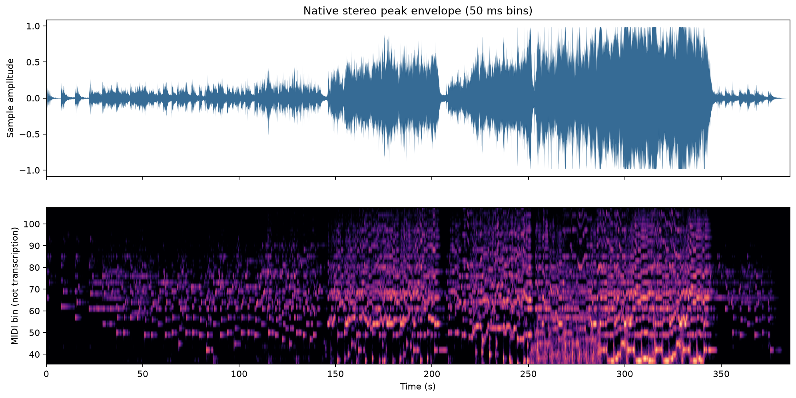
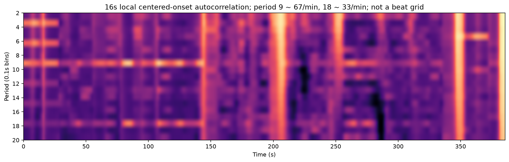

# 《意难忘》全曲结构分析

对象与限制见 [README](README.md)。以下基于实际 FLAC、计算特征和频谱图检查，**没有听觉复核**。段落编号是为复查服务的工作划分，不是确定的乐谱曲式。尤其不能把表里的“展开”“回返”“收束”直接等同于听众的情绪。

## 1. 三层证据

- **Level 1 / L1：声学观察。** 能量、频带分布、起音变化、按顺序相似的 CQT/chroma 轨迹。
- **Level 2 / L2：音乐结构解释。** 同材料回返、乐句分组、推进与中断的候选关系。仍待听辨确认主次声部与句法。
- **Level 3 / L3：具身体验假设。** 紧张、沉重、扩张、悬置、释放等体验及其身体位置。本文件不把它们作为实测结论。

## 2. 带时间戳的全曲工作结构表

RMS 是原始双声道段落能量，质心是 mono 频谱质心的时间平均。不能把两者当作配器名称或情绪量表。边界写到 0.1 秒方便寻址；实际句法边界须在前后 1–2 秒范围试听。

| 段落 | 范围（分:秒） | L1：可复核的变化 | L2：结构解释及待确认点 |
| --- | --- | --- | --- |
| S01 | 00:00.0–00:22.0 | RMS −33.3 dBFS，质心 693 Hz；约 00:00.5、00:07.6、00:14.8 有相隔约 7 秒的明显起音/衰减事件，音高分布不相同；间隔中仍有衰减尾音 | 可划为三个稀疏声音事件组成的引入。尚不能把它们判成同一旋律动机的三次陈述，更不能把低能量间隔都写作休止 |
| S02 | 00:22.0–00:57.8 | −28.2 dBFS，614 Hz；能量不再每次衰减到开头的低水平；约 00:29 起中高频轨迹更活跃，低音频谱位置多次转换 | 较连续材料的建立区。00:22 是显著声学入口，00:29–00:37 可作为首次活动旋律的听辨检查点；**不能据此确认“主旋律首次出现”** |
| S03 | 00:57.8–01:26.5 | −27.5 dBFS，549 Hz；包含 M1、M2、M3 三个相继短序列模板 | 第一组明确可检索的连续材料。M1→M2→M3 是材料顺序，不预设为问句→答句→终止 |
| S04 | 01:26.5–01:55.2 | −25.5 dBFS，683 Hz；三个短序列分别在 +28.7 秒附近回返，整窗 DTW 0.870；比 S03 高约 2.0 dB | S03 的回返/重述候选。材料身份较稳定，包络和频谱有所变化。不是波形完全相同的复制 |
| S05 | 01:55.2–02:25.8 | −24.6 dBFS，835 Hz；中高频活动增加；随后约 02:23–02:25 能量显著下落，02:25.8 又进入新能量层 | 第一大区间的延展及转接候选。01:55.2 是按回返长度选的工作界线，不是明确切口。是否未完成乐句，需要听辨 |
| S06 | 02:25.8–02:54.5 | −17.7 dBFS，1238 Hz；相对 S05 约 +6.9 dB；高于 2 kHz 的平均能量比例从约 0.6% 到 3.8%；M4 在 02:26.0、02:40.3 附近有相关轨迹 | 新音响层次与波动型材料进入。可解释为第一次明显扩展；不能以算法确认“弦乐齐奏/某管乐入场” |
| S07 | 02:54.5–03:23.7 | −15.2 dBFS，1443 Hz；M4 相关材料在 02:54.7、03:09.0；M5 在 03:18.5–03:24.5；长窗与 S06 的 DTW 仅 0.746 | 延续并改写前一区间，而不是完整照搬。约 14.3/28.7 秒的材料间距支持层级组织；后半句差异较大 |
| S08 | 03:23.7–03:28.0 | −31.7 dBFS，579 Hz；相对 S07 低约 16.5 dB；CQT 占用率约 7.9%，但仍有声音；低频比例约 68% 是其他频带撤去后的相对量 | 清楚的收缩/停顿区。可供检验“期待被暂时截住”；尚不能称为谱面全休止或和声悬置 |
| S09 | 03:28.0–03:42.1 | −21.0 dBFS，1346 Hz；从低能量区恢复，中高频活动重现 | 较弱力度重新开始的连接区。是否为同主题换声部或新材料，当前证据不足 |
| S10 | 03:42.1–04:12.5 | −15.5 dBFS，1662 Hz；后段逐渐增强；≥2 kHz 比例约 9.3%，高于后面更响的段落；04:12 左右再出现短暂能量谷 | 第二轮推进区；“亮度较高”与“响度最高”并不重合，提醒不要把张力简化为一个强度旋钮 |
| S11 | 04:12.5–04:45.7 | −13.2 dBFS，1194 Hz；短暂回落后低于 250 Hz 的平均比例约 64%；CQT 占用率约 26.6%，是工作分段中最高值；约 04:13 与 04:27 存在较弱的 14.3 秒相关轨迹 | 低频与宽频活动较显著的过渡/展开区。可提出“重量变化”，不能确认具体低音乐器、鼓点或低声部数量。04:13↔04:27 尚未列入核心动机 |
| S12 | 04:45.7–05:14.4 | −10.1 dBFS，1427 Hz；M4 相关片段在 04:45.7、05:00.0；与 S13 前 28.7 秒 DTW 0.841 | 较强音响条件下的材料回返。跨段 M4 同一性的证据为中等，不能只因为位置整齐就认定同一主题 |
| S13 | 05:14.4–05:44.6 | −10.3 dBFS，1423 Hz；并未比 S12 继续增响；M4 相关片段在 05:14.4、05:28.7，M5 在 05:38.2–05:44.2；末端明显撤去能量 | 强音响平台内的再陈述与收束。不是一条持续上升直到结尾的曲线；05:14.4 的 M4 身份证据尤其弱，保留为关联变形候选 |
| S14 | 05:44.6–06:14.4 | −30.7 dBFS，550 Hz；比 S13 低约 20.4 dB；≥2 kHz 比例降至约 0.04%；M6 两次仍具有序列相似性 | 显著减薄后的尾声候选。材料并未随音量一并消失；05:51.0 与 06:06.3 是“减弱中的重复”优先试听点 |
| S15 | 06:14.4–06:25.631 | −40.7 dBFS；06:14.4 附近有尾段起音，之后长衰减；最后极低能量帧的质心不稳定，不应解释为突然增加亮音色 | 最后余响/衰减。声音结束可确认；“调性圆满解决”“接受痛苦后的释然”均不能由此确认 |

数据：[section_features.csv](data/section_features.csv)、[boundary_candidates.csv](data/boundary_candidates.csv)。



## 3. 哪些地方是结构变化，哪些可能只是同一段内部的起伏

**00:22、02:25.8、03:23.7–03:28、05:44.6** 同时得到能量和频谱变化的支持，是较可靠的声学区界。约 01:26.5、02:54.5、05:14.4 则主要依据材料回返周期定位，音乐可以连续跨过边界；没有“必须在这里停一下”的声学要求。

多尺度变化曲线在 00:07.6、00:14.8 也给出高峰。这些是开头声音事件的变化，不必升级为与中部大区间同等级的段落。06:21.6 的高变化分数很大程度来自淡出和近静音，不是新的主题。**变化强度排序不是曲式层级排序。**

## 4. 主旋律、短动机与乐句关系

目前能准确说的是“最早的高可信短序列重复模板从 00:57.8 开始”，不能说“主旋律直到 00:57.8 才出现”。00:00.5 的持续音、00:22 的新音高组合、00:29 后更活跃的轨迹，都可能参与更早的主题建立；上层 CQT 里同时含主旋律、伴奏及泛音，无法在没有听辨的情况下给它们可靠排序。

最明确的嵌套关系是：

```text
00:57.8                     01:26.5                     01:55.2
   M1 — M2 — 连接 — M3 — 尾部   |   M1 — M2 — 连接 — M3 — 尾部
             约28.7秒                        约28.7秒
```

这里 M1–M3 都短于 10 秒，长窗相似性不是唯一依据。它们在第二轮保持先后次序和近似间距，低频序列也较一致；但 onset 包络相关较低，说明纹理或重音活动并非逐帧复刻。不能把后者单独归因为“演奏者故意拖拍”。

02:26–03:24 与 04:45.7–05:44.6 则存在 M4 与 M5 的相关材料。特别是 **M5 后面的去向不同**：第一处进入约 4 秒的低能量区并重新推进；后一处进入长时间较弱尾段。这为“相似结尾在不同上下文中产生不同意义”提供了可听辨的对照，不必先假设一次是悬念、一次是情感解决。

## 5. 节奏与时值：有周期线索，尚无微时值结论

起音包络在 00:22–01:55、03:28–04:12.5、04:13–05:44 的自相关中，约 **0.9 秒**为显著周期，并有约 1.8、2.7 秒的倍周期。若 0.9 秒作为一拍，约为 67 次/分；若把更短层级作为拍，速度标签会翻倍。**未确认拍号、强拍或每句的小节数。**

28.7 秒与约 0.897 秒的 32 个单位相容，14.3 秒与约 16 个单位相容。这是检索一致性线索，不是已验证的“八小节主题”。尾段 05:48–06:14 的显著短周期约 0.5 秒，M6 起点间距约 15.3 秒，也不能直接拿它与 M4 的 14.3 秒相比后宣称慢了多少：材料和取窗方式不同。

目前 **没有证实某个音延迟几十毫秒、某处呼吸被故意拉长或哪个声部错过入场**。要检验，需先人工标同一旋律的对应起音，再回到 23.22 ms 帧或原波形上测量，报告标注者间误差。DTW 只说明有限时间伸缩能改善匹配。



## 6. 和声与低音：能确定“语境有变”，不能直接命名功能

全曲 chroma 有反复的音高类别分布，局部图中可见 C#、F#、A、E、G# 等位置反复占优；这并不足以在 F# 小调、相关调式或更复杂的局部和声之间做定论。低频 CQT 还混有泛音、邻 bin 泄漏与宽频起音，不能把每帧最大项当作低音谱。

可复核的比较包括：

- M1、M2 回返的低频 chroma 余弦约 **0.87**；M3 约 **0.98**。这些支持“相似上层材料与相近低频语境一起回返”。它们并不等于完整和弦完全相同。
- M4 的 02:26.0→02:40.3，低频相似度约 **0.50**，上层 DTW 仍约 **0.82**。这是“材料较相近、低频语境明显不同”的候选实例。
- M6 的 05:51.0→06:06.3，上层 DTW 约 **0.89**，低频相似度仅 **0.48**。它比单纯“结尾越来越弱”的说法更值得检验。

目前不能确认的项目包括：罗马数字和声进行、转调时刻、属和弦延宕、挂留音解决、阻碍终止或最后是否回到主和弦。它们都需要可分辨的低音与和弦音，并判断句法预期。**把上述低频差异叫作“潜在重新配和声”是 L2；说“这里一定用了延迟解决”超出证据。**

## 7. 织体、音区与配器：避免把频带认成乐器

02:25.8 后高频活动与能量增加，03:23.7 后共同收缩，04:12.5 后低频比例增强，05:44.6 后高频撤去，这些都是真实的混音层面变化。但低音增强可以来自低音乐器进入，也可能来自已有声部换音、倍增、均衡、动态处理或其他声部撤去。**当前没有一项“某乐器进入/退出”达到听辨确认等级。**

M4 的 02:26.0 与 05:00.0 对照中，全 CQT 加权音高中心从约 MIDI 63.1 降至 57.0，而能量提高约 11.2 dB。这说明“增强”伴随的是整体频谱权重下移，不能说“旋律越唱越高”。音高中心包含伴奏和泛音，也不能证明主旋律降了六个半音。

原始立体声与 mono 的 RMS 分别保留，避免平均声道后的抵消造成错误比较。side/mid 的确随段落变化，但没有声道分离听辨、混响参数或播放条件，无法确认某次重复从“远处”移动到“身体内部”。

## 8. 情绪累积、转折、释放的待验证落点

| 试听位置 | 已知的声音变化 | 可以问的问题，均为 L2/L3 |
| --- | --- | --- |
| 00:57.8→01:26.5 | 三个短序列按原顺序返回，约增加 2 dB | 再认出是否使后续走向更容易预测？能量匹配后仍有区别吗？ |
| 02:26.0→03:09.0 | 相关短材料重复，低频语境、包络和频谱不同 | 体验是累积、摆动、疲劳还是没有明显变化？ |
| 03:23.7–03:28.0 | 大幅收缩，仍有低能量声音 | 是松一口气、被截断，还是单纯段落间隔？ |
| 03:42.1→04:12.5 | 相对亮的持续推进后短回落 | 亮度、节奏活动和响度哪个更能解释感受？ |
| 04:45.7→05:44.6 | 强音响回返、后段大幅撤去能量 | 最后一轮相似材料是否改变对结尾的预期？ |
| 05:51.0→06:13.3 | 低声量中的重复，低频分布改变 | 是否仍有方向性？如果有，说明整体现象不能只归于渐强 |

没有独立听感记录之前，不把这些落点贴上“胸口—腹部—喉咙”的预设标签。
